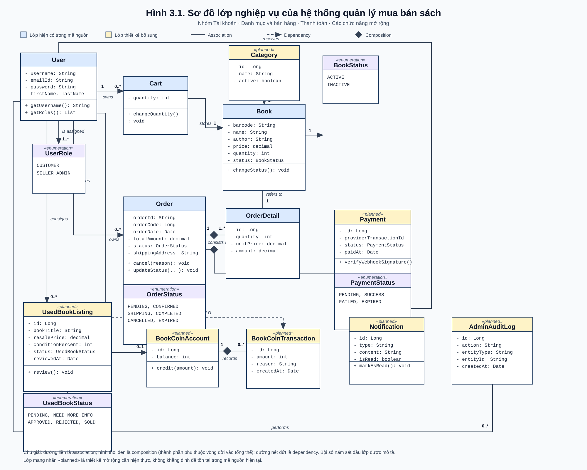
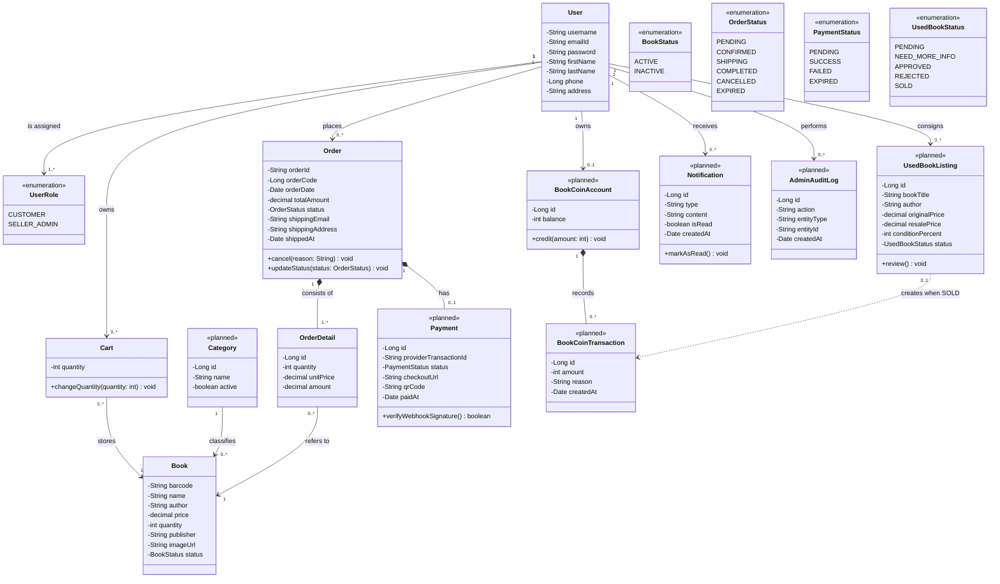

# Hình 3.1. Sơ đồ lớp nghiệp vụ của hệ thống quản lý mua bán sách

Sơ đồ mô tả các lớp miền nghiệp vụ trung tâm, là mức trừu tượng phù hợp để trình bày trong báo cáo. Những lớp mang nhãn `«planned»` là thành phần thiết kế cần bổ sung cho sản phẩm của học phần hiện tại. Các lớp `User`, `Book`, `Cart`, `Order`, `OrderDetail`, `UserRole` và `OrderStatus` đối chiếu với cấu trúc mã nguồn hiện có; các thuộc tính mở rộng của `Book`, trạng thái `EXPIRED` và những thành phần còn lại là thiết kế hoàn thiện.

**Chú giải:** đường liền biểu thị association; hình thoi đen biểu thị composition; đường nét đứt biểu thị dependency. Bội số được ghi sát đầu lớp mà nó mô tả.
