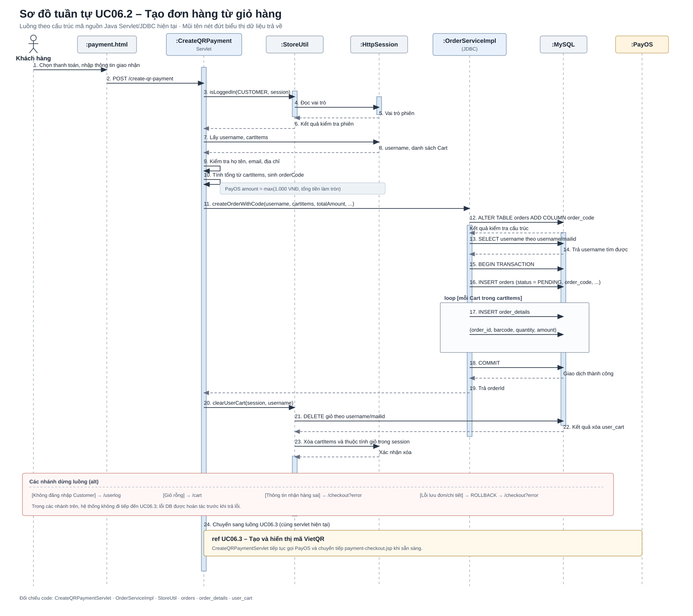

# Hình 2.x. Sơ đồ tuần tự UC06.2 – Tạo đơn hàng từ giỏ hàng



Sơ đồ dưới đây mô tả luồng theo cấu trúc và mã nguồn hiện tại. Việc tạo mã VietQR thuộc UC06.3; trong mã nguồn, phần này được thực hiện tiếp trong cùng `CreateQRPaymentServlet` sau khi tạo đơn.

```mermaid
sequenceDiagram
    autonumber
    actor KH as Khách hàng
    participant UI as :payment.html
    participant Servlet as :CreateQRPaymentServlet
    participant Util as :StoreUtil
    participant Session as :HttpSession
    participant Service as :OrderServiceImpl
    participant DB as :MySQL
    participant PayOS as :PayOS

    KH->>UI: Chọn thanh toán, nhập thông tin giao nhận
    UI->>Servlet: POST /create-qr-payment
    activate Servlet
    Servlet->>Util: isLoggedIn(CUSTOMER, session)
    Util->>Session: Đọc vai trò đăng nhập
    Session-->>Util: Vai trò phiên
    Util-->>Servlet: Kết quả kiểm tra phiên

    alt Chưa đăng nhập Customer
        Servlet-->>UI: Chuyển hướng /userlog
        UI-->>KH: Hiển thị trang đăng nhập
    else Đã đăng nhập Customer
        Servlet->>Session: Lấy username, cartItems
        Session-->>Servlet: username, danh sách sách trong giỏ
        alt Giỏ hàng rỗng
            Servlet-->>UI: Chuyển hướng /cart
            UI-->>KH: Hiển thị giỏ hàng
        else Giỏ hàng có sách
            Servlet->>Servlet: Kiểm tra họ tên, email, địa chỉ
            alt Thông tin giao nhận không hợp lệ
                Servlet-->>UI: Chuyển hướng /checkout?error=...
                UI-->>KH: Hiển thị yêu cầu nhập lại thông tin
            else Thông tin giao nhận hợp lệ
                Servlet->>Servlet: Tính tổng từ cartItems, sinh orderCode
                Note right of Servlet: amountInt = max(1.000 VNĐ, tổng tiền đã làm tròn)
                Servlet->>Service: createOrderWithCode(username, cartItems, totalAmount, email, address, paymentMethod, orderCode)
                activate Service
                Service->>DB: Kiểm tra/thêm cột orders.order_code
                Service->>DB: Tìm username chuẩn hóa từ users
                DB-->>Service: username hợp lệ (nếu tìm thấy)
                Service->>DB: BEGIN TRANSACTION
                Service->>DB: INSERT orders (status = PENDING, order_code, thông tin giao nhận)
                loop Với mỗi sách trong cartItems
                    Service->>DB: INSERT order_details (barcode, quantity, amount)
                end
                alt Lưu đơn và chi tiết thành công
                    Service->>DB: COMMIT
                    DB-->>Service: Giao dịch thành công
                    Service-->>Servlet: orderId
                    deactivate Service
                    Servlet->>Util: clearUserCart(session, username)
                    activate Util
                    Util->>DB: DELETE FROM user_cart của khách hàng
                    DB-->>Util: Kết quả xóa giỏ đã lưu
                    Util->>Session: Xóa cartItems và thuộc tính giỏ liên quan
                    Session-->>Util: Xác nhận xóa thuộc tính phiên
                    Util-->>Servlet: Hoàn tất xóa giỏ
                    deactivate Util
                    ref over Servlet,PayOS: UC06.3 – Tạo và hiển thị mã VietQR
                else Lỗi khi lưu đơn hoặc chi tiết
                    Service->>DB: ROLLBACK
                    DB-->>Service: Giao dịch được hoàn tác
                    Service-->>Servlet: Ném StoreException
                    deactivate Service
                    Servlet-->>UI: Chuyển hướng /checkout?error=...
                    UI-->>KH: Hiển thị lỗi tạo giao dịch
                end
            end
        end
    end
    deactivate Servlet
```

**Ghi chú đối chiếu mã nguồn:**

- `CreateQRPaymentServlet` lấy `cartItems` từ `HttpSession`, tính tổng tiền từ các đối tượng `Cart`, rồi gọi `OrderService.createOrderWithCode(...)`.
- `OrderServiceImpl` dùng `PreparedStatement` trực tiếp (không có lớp DAO riêng trong luồng này), tạo bản ghi `orders` và các dòng `order_details` trong một giao dịch JDBC. Khi xảy ra `SQLException`, giao dịch được rollback.
- Sau khi dịch vụ trả về `orderId`, `StoreUtil.clearUserCart(...)` xóa giỏ trong phiên và bảng `user_cart`; bước gọi PayOS và hiển thị trang thanh toán tiếp tục trong cùng servlet theo UC06.3.
- Đặc tả UC06.2 yêu cầu đọc lại giá và tồn kho, chống tạo đơn trùng bằng idempotency key. Luồng mã nguồn được vẽ hiện chưa có các bước này: tổng tiền và số lượng lấy từ `cartItems` trong phiên, không có truy vấn đọc lại giá/tồn kho trước khi tạo đơn và chưa thấy kiểm tra idempotency key.
- `OrderServiceImpl` tự kiểm tra/thêm cột `orders.order_code` trước khi bắt đầu transaction; đây là thao tác khởi tạo cấu trúc dữ liệu đang có trong code, không phải bước nghiệp vụ cần lặp cho mỗi yêu cầu khi triển khai ổn định.
