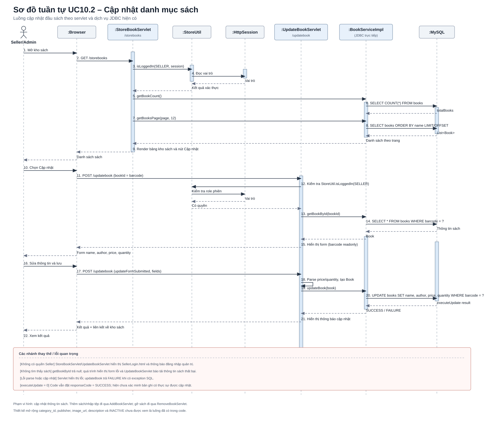

# Hình 2.x. Sơ đồ tuần tự UC10.2 – Cập nhật danh mục sách



Sơ đồ tập trung vào luồng chính cập nhật một đầu sách theo code hiện tại: xem kho, tải sách bằng `barcode`, sửa thông tin và lưu vào cơ sở dữ liệu.

```mermaid
sequenceDiagram
    autonumber
    actor Seller as Quản trị viên/Người bán
    participant Browser as :Trình duyệt
    participant Store as :StoreBookServlet
    participant Util as :StoreUtil
    participant Session as :HttpSession
    participant Update as :UpdateBookServlet
    participant Service as :BookServiceImpl
    participant DB as :MySQL

    Seller->>Browser: Mở kho sách
    Browser->>Store: GET /storebooks
    activate Store
    Store->>Util: isLoggedIn(SELLER, session)
    Util->>Session: Đọc vai trò phiên
    Session-->>Util: Vai trò đăng nhập
    Util-->>Store: Kết quả kiểm tra quyền
    alt Không có phiên Seller
        Store-->>Browser: Include SellerLogin.html, báo yêu cầu đăng nhập
        Browser-->>Seller: Hiển thị trang đăng nhập
    else Có quyền Seller
        Store->>Service: getBookCount()
        activate Service
        Service->>DB: SELECT COUNT(*) FROM books
        DB-->>Service: Tổng số đầu sách
        Service-->>Store: totalBooks
        Store->>Service: getBooksPage(page, 12)
        Service->>DB: SELECT books ORDER BY name LIMIT ? OFFSET ?
        DB-->>Service: Danh sách Book theo trang
        Service-->>Store: List<Book>
        deactivate Service
        Store-->>Browser: Render bảng kho sách và nút Cập nhật
        Browser-->>Seller: Hiển thị danh sách đầu sách

        Seller->>Browser: Chọn Cập nhật một sách
        Browser->>Update: POST /updatebook (bookId = barcode)
        activate Update
        Update->>Util: isLoggedIn(SELLER, session)
        Util->>Session: Đọc vai trò phiên
        Session-->>Util: Vai trò đăng nhập
        Util-->>Update: Kết quả kiểm tra quyền
        alt Phiên không hợp lệ
            Update-->>Browser: Include trang SellerLogin và thông báo
            Browser-->>Seller: Yêu cầu đăng nhập quản trị
        else Đã đăng nhập Seller
            Update->>Service: getBookById(bookId)
            activate Service
            Service->>DB: SELECT * FROM books WHERE barcode = ?
            DB-->>Service: Thông tin đầu sách
            Service-->>Update: Book
            deactivate Service
            Update-->>Browser: Hiển thị form (barcode chỉ đọc)
            Browser-->>Seller: Nhập name, author, price, quantity
            Seller->>Browser: Gửi form cập nhật
            Browser->>Update: POST /updatebook (updateFormSubmitted, dữ liệu sách)
            Update->>Update: Parse price, quantity; tạo Book
            Update->>Service: updateBook(book)
            activate Service
            Service->>DB: UPDATE books SET name, author, price, quantity WHERE barcode = ?
            DB-->>Service: Kết quả executeUpdate()
            Service-->>Update: SUCCESS hoặc FAILURE
            deactivate Service
            alt Dịch vụ trả SUCCESS
                Update-->>Browser: Hiển thị thông báo cập nhật thành công
            else Lưu thất bại hoặc dữ liệu không parse được
                Update-->>Browser: Hiển thị thông báo cập nhật/tải dữ liệu thất bại
            end
            Browser-->>Seller: Xem kết quả và liên kết về kho sách
        end
        deactivate Update
    end
    deactivate Store
```

**Ghi chú đối chiếu code và phạm vi:**

- `StoreBookServlet` lấy tổng số sách và trang sách qua `BookServiceImpl`; `UpdateBookServlet` xử lý cả việc tải form và nhận form cập nhật tại `/updatebook`.
- `BookServiceImpl` truy cập MySQL trực tiếp bằng `PreparedStatement`, chưa có DAO riêng trong luồng này. Bảng sách đang được cập nhật gồm `barcode`, `name`, `author`, `price`, `quantity`; `barcode` được giữ chỉ đọc trên form.
- `AddBookServlet` có luồng thêm một sách và nhập nhiều sách từ tệp `.txt`/`.csv`. Sơ đồ này tập trung vào luồng cập nhật chính để giữ độ dài phù hợp một trang.
- Đặc tả UC10.2 mở rộng thêm `category_id`, `publisher`, `image_url`, `description`, trạng thái `ACTIVE/INACTIVE` và nhập CSV nguyên tử. Các trường mở rộng/chức năng này chưa được thể hiện như đã triển khai trong sơ đồ code hiện tại. `RemoveBookServlet` hiện xóa vật lý; thao tác chuyển `INACTIVE` là phần cần phát triển theo đặc tả.
- Trong `BookServiceImpl.updateBook`, kết quả `executeUpdate()` chưa được kiểm tra số dòng bị ảnh hưởng trước khi trả `SUCCESS`; do đó sơ đồ chỉ mô tả phản hồi hiện tại của hàm, không khẳng định bản ghi chắc chắn đã thay đổi.
