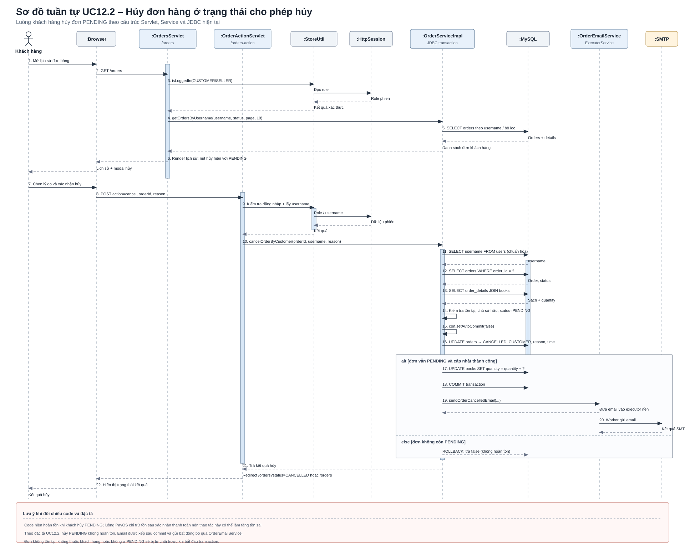

# Hình 2.x. Sơ đồ tuần tự UC12.2 – Hủy đơn hàng ở trạng thái cho phép hủy



Sơ đồ tập trung vào luồng khách hàng hủy đơn `PENDING` theo mã nguồn hiện tại. Các bước đọc đơn, xác minh chủ sở hữu/trạng thái, cập nhật trong transaction, hoàn tồn và gửi email được thể hiện riêng.

```mermaid
sequenceDiagram
    autonumber
    actor Customer as Khách hàng
    participant Browser as :Trình duyệt
    participant Orders as :OrdersServlet
    participant Action as :OrderActionServlet
    participant Util as :StoreUtil
    participant Session as :HttpSession
    participant Service as :OrderServiceImpl
    participant DB as :MySQL
    participant Email as :OrderEmailService
    participant SMTP as :Mail Server

    Customer->>Browser: Mở lịch sử đơn hàng
    Browser->>Orders: GET /orders
    activate Orders
    Orders->>Util: Kiểm tra vai trò Customer/Seller
    Util->>Session: Đọc thuộc tính vai trò
    Session-->>Util: Vai trò phiên
    Util-->>Orders: Kết quả xác thực
    Orders->>Service: getOrdersByUsername(username, status, page, size)
    activate Service
    Service->>DB: SELECT orders của khách hàng
    DB-->>Service: Danh sách Order
    Service-->>Orders: Danh sách đơn và chi tiết
    deactivate Service
    Orders-->>Browser: Render lịch sử; nút hủy cho đơn PENDING
    Browser-->>Customer: Hiển thị lịch sử đơn hàng
    deactivate Orders

    Customer->>Browser: Chọn hủy, chọn/nhập lý do, xác nhận
    Browser->>Action: POST /orders-action (action=cancel, orderId, reason)
    activate Action
    Action->>Util: isLoggedIn(CUSTOMER, session)
    Util->>Session: Đọc vai trò và username Customer
    Session-->>Util: Dữ liệu phiên
    Util-->>Action: Quyền và trạng thái đăng nhập
    Action->>Service: cancelOrderByCustomer(orderId, username, reason)
    activate Service
    Service->>DB: SELECT username từ users để chuẩn hóa
    DB-->>Service: username hợp lệ
    Service->>DB: SELECT đơn theo order_id
    DB-->>Service: Order và trạng thái hiện tại
    Service->>DB: SELECT order_details JOIN books theo order_id
    DB-->>Service: Các sách và số lượng trong đơn
    Service->>Service: Kiểm tra đơn tồn tại, chủ sở hữu, status=PENDING
    alt Đơn không tồn tại, không thuộc khách hàng hoặc không ở PENDING
        Service-->>Action: StoreException
        Action-->>Browser: Redirect /orders, báo không thể hủy
        Browser-->>Customer: Hiển thị lý do thất bại
    else Đơn thuộc khách hàng và đang PENDING
        Service->>Service: con.setAutoCommit(false)
        Service->>DB: UPDATE orders SET CANCELLED, cancelled_by, reason, cancelled_at WHERE status=PENDING
        alt Cập nhật đúng 1 đơn
            loop Mỗi OrderDetail
                Service->>DB: UPDATE books SET quantity = quantity + số lượng
            end
            Service->>DB: COMMIT
            Service->>Email: sendOrderCancelledEmail(order, reason, CUSTOMER)
            activate Email
            Email-->>Service: Đưa email vào executor nền
            deactivate Email
            Service-->>Action: true
            Action-->>Browser: Redirect /orders?status=CANCELLED
            Browser-->>Customer: Hiển thị đơn đã hủy
        else Đơn không còn PENDING (ví dụ webhook đổi trạng thái trước)
            Service->>DB: ROLLBACK
            Service-->>Action: false
            Action-->>Browser: Redirect /orders, báo không thể hủy
            Browser-->>Customer: Hiển thị kết quả thất bại
        end
    end
    deactivate Service
    deactivate Action

    opt Email đã được xếp sau khi hủy thành công
        Email->>SMTP: Gửi email thông báo hủy
        SMTP-->>Email: Kết quả gửi
    end
```

**Ghi chú đối chiếu code và đặc tả:**

- `OrdersServlet` chỉ hiển thị nút hủy cho đơn `PENDING`; modal gửi `action=cancel`, `orderId` và `reason` tới `OrderActionServlet`.
- `OrderServiceImpl.cancelOrderByCustomer` xác minh đơn, chủ sở hữu và trạng thái trước; sau đó cập nhật `orders` có điều kiện `status = 'PENDING'`, hoàn số lượng theo `order_details` và commit transaction. Cập nhật có điều kiện bảo vệ trường hợp trạng thái thay đổi đồng thời.
- Code hiện hoàn tồn cho đơn `PENDING`. Trong luồng PayOS của ứng dụng, tồn kho chỉ được trừ khi webhook xác nhận thanh toán; vì vậy hoàn tồn ở đây có thể làm tăng sai số lượng. Đặc tả UC12.2 quy định hủy `PENDING` không hoàn tồn; đây là điểm cần sửa khi triển khai theo yêu cầu môn mới.
- Sau commit, `OrderEmailService` đưa email vào `ExecutorService` nền; lỗi gửi email không làm đảo ngược trạng thái đơn. Bản ghi gửi lại tự động chưa được mô tả trong luồng code.
