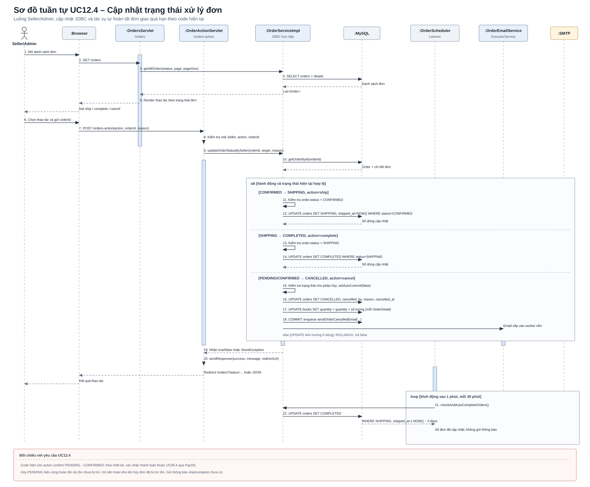
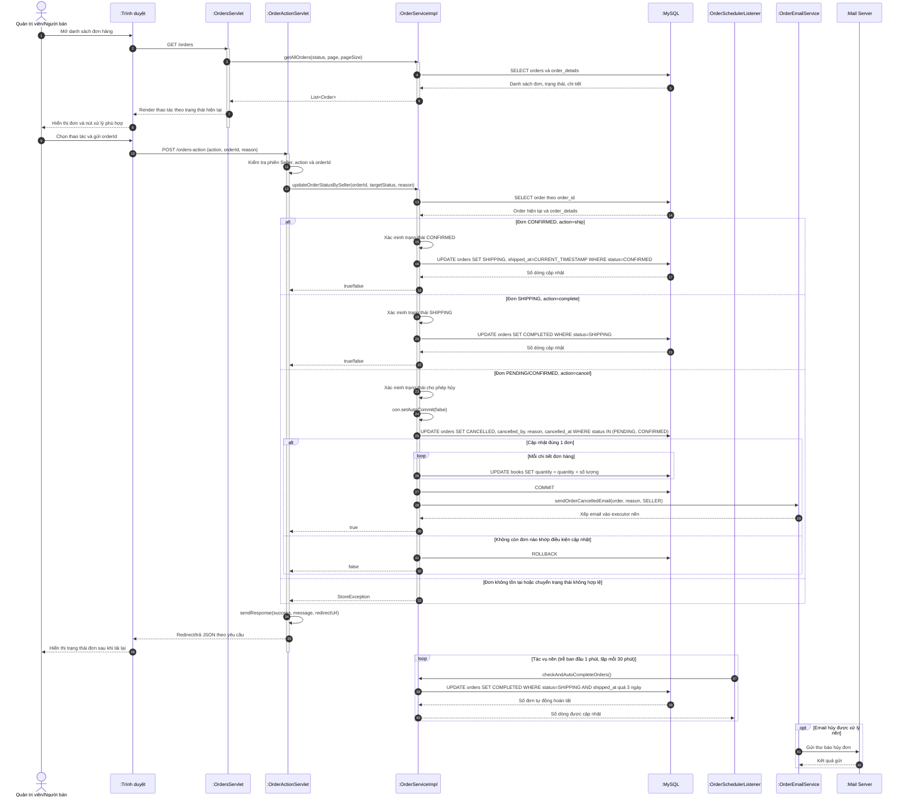

# Hình 2.x. Sơ đồ tuần tự UC12.4 – Cập nhật trạng thái xử lý đơn

Sơ đồ thể hiện luồng quản trị viên/người bán chuyển đơn sang `SHIPPING`, các nhánh hoàn tất/hủy và tác vụ nền tự hoàn tất đơn giao quá hạn theo mã nguồn hiện tại.

**Ghi chú đối chiếu code và đặc tả:**

- `OrdersServlet` hiển thị thao tác theo trạng thái; `OrderActionServlet` nhận `ship`, `complete`, `cancel` (và các action khác) rồi gọi `OrderServiceImpl.updateOrderStatusBySeller(...)`.
- Chuyển `CONFIRMED → SHIPPING` lưu `shipped_at`; chuyển `SHIPPING → COMPLETED` cập nhật trạng thái. Bộ lập lịch `OrderSchedulerListener` chạy lần đầu sau 1 phút, sau đó mỗi 30 phút; cập nhật các đơn `SHIPPING` đã quá 3 ngày. Tác vụ này không kiểm tra bằng chứng giao hàng thực tế và không gửi thông báo trạng thái.
- Email hủy được xếp gửi nền sau commit. Code hiện không gửi email/thông báo khi chuyển sang `SHIPPING` hoặc `COMPLETED`.
- `OrderActionServlet` hiện vẫn cho Seller dùng action `confirm` để chuyển `PENDING → CONFIRMED`; theo đặc tả, bước xác nhận thanh toán này phải do UC06.4 xử lý qua webhook PayOS.
- Khi Seller hủy đơn, `OrderServiceImpl` hoàn tồn kho cho cả `PENDING` và `CONFIRMED`. Theo quy tắc tồn kho của luồng PayOS, đơn `PENDING` chưa bị trừ tồn nên hủy đơn này không được hoàn tồn; đơn đã thanh toán cần theo dõi hoàn tiền riêng.
- Sơ đồ dùng `OrderServiceImpl` trực tiếp truy vấn MySQL qua JDBC; dự án không có DAO riêng cho luồng này.
