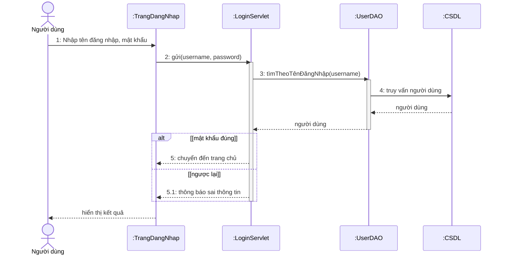

# Hướng dẫn vẽ sơ đồ tuần tự (Sequence Diagram)

Tài liệu này tóm tắt cách vẽ sơ đồ tuần tự đúng chuẩn UML cho báo cáo đồ án, dựa trên các sơ đồ mẫu và bảng đặc tả use case. Các tên lớp trong ví dụ chỉ để minh họa, hãy thay bằng tên thật trong dự án của bạn.

---

## 1. Sơ đồ tuần tự dùng để làm gì

- Cho biết **ai gọi ai, theo thứ tự nào** để hoàn thành một use case.
- Bổ sung cho bảng đặc tả: bảng mô tả *làm gì*, sơ đồ tuần tự mô tả *các đối tượng phối hợp thế nào*.
- Khác với sơ đồ hoạt động: sơ đồ hoạt động vẽ **các bước và rẽ nhánh**, sơ đồ tuần tự vẽ **thông điệp giữa các đối tượng theo thời gian** (từ trên xuống dưới).

**Quy ước số lượng:** mỗi bảng đặc tả use case thường có **một** sơ đồ tuần tự, tập trung vào luồng chính. Luồng thay thế và ngoại lệ chỉ vẽ khi quan trọng, bằng khung `alt`, `opt`, `loop`.

---

## 2. Các thành phần và ký hiệu

| Thành phần | Cách vẽ | Ghi chú |
|---|---|---|
| **Actor** | Hình người que, đặt ngoài cùng bên trái | Lấy từ *Primary Actor* của bảng đặc tả |
| **Đối tượng (lifeline)** | Hộp tiêu đề ở trên, đường nét đứt đi xuống | Tên dạng `:TênLớp` hoặc `tênĐốiTượng : TênLớp` |
| **Thanh kích hoạt (activation bar)** | Hình chữ nhật hẹp trên lifeline | Chỉ vẽ lúc đối tượng đang xử lý; bắt đầu khi nhận thông điệp, kết thúc khi trả lời |
| **Thông điệp gọi** | Mũi tên ngang, nét liền, đầu mũi tên đặc hoặc hở | Nhãn ngắn, đặt phía trên mũi tên |
| **Thông điệp trả về** | Mũi tên nét đứt, đầu mũi tên hở | Chỉ vẽ khi trả về có ý nghĩa |
| **Gọi chính mình** | Mũi tên uốn quay lại cùng lifeline | Thanh kích hoạt lồng nhỏ bên trong |
| **Thông điệp tìm thấy** | Chấm đen ở đầu mũi tên | Không rõ người gửi (ví dụ sự kiện từ bên ngoài) |
| **Thông điệp mất** | Vòng tròn ở cuối mũi tên | Thông báo gửi đi không ai nhận trong phạm vi sơ đồ |
| **Khung kết hợp (fragment)** | Hình chữ nhật có nhãn toán tử ở góc trên trái | Xem mục 4 |
| **Tham chiếu (`ref`)** | Khung có nhãn `ref` | Trỏ sang sơ đồ khác (ví dụ UC khác) |

---

## 3. Quy trình vẽ từ bảng đặc tả use case

### Bước 1. Xác định đối tượng
Đọc *Normal Flow* và liệt kê ai tham gia. Với ứng dụng web Java Servlet/JSP, thường có:

| Loại | Ví dụ vai trò | Đặt tên minh họa |
|---|---|---|
| Actor | Người dùng thao tác | `Khách hàng` |
| Boundary (giao diện) | Trang JSP | `:TrangThanhToan` |
| Control (điều khiển) | Servlet | `:CheckoutServlet` |
| Control/Service | Lớp nghiệp vụ | `:OrderService` |
| Entity/DAO | Truy cập dữ liệu | `:OrderDAO` |
| Hệ thống ngoài | Cổng thanh toán, máy chủ thư | `:PayOS`, `:MailServer` |

Chỉ vẽ đối tượng **thật sự tham gia** vào luồng đang vẽ. Đối tượng không có thông điệp nào thì bỏ.

### Bước 2. Sắp xếp cột
Từ **trái sang phải theo thứ tự xuất hiện trong luồng**: actor, giao diện, controller, service, DAO/cơ sở dữ liệu, hệ thống ngoài. Tránh để hai đối tượng hay trao đổi với nhau nằm xa nhau.

### Bước 3. Chuyển từng bước của Normal Flow thành thông điệp
Quy tắc đổi:

| Câu trong bảng đặc tả | Thông điệp trong sơ đồ |
|---|---|
| "Khách hàng chọn / nhập / xác nhận…" | Mũi tên từ actor sang giao diện |
| "Hệ thống kiểm tra / tính toán…" (do một lớp tự làm) | Mũi tên gọi chính mình, hoặc gọi hàm của service |
| "Hệ thống đọc / lưu / xóa dữ liệu…" | Service gọi DAO, DAO truy vấn cơ sở dữ liệu |
| "Hệ thống hiển thị…" | Thông điệp trả về giao diện, rồi giao diện hiển thị cho actor |
| "Hệ thống gọi PayOS / gửi thư…" | Mũi tên tới đối tượng hệ thống ngoài |

Mỗi bước của đặc tả có thể thành **một hoặc vài** thông điệp, hoặc **gộp** nếu chỉ là xử lý nội bộ.

### Bước 4. Đánh số thông điệp
Đánh số `1`, `2`, `3`, … theo thứ tự. Thông điệp lồng trong khung hoặc lời gọi con có thể đánh `1.1`, `1.2`. Số thông điệp **không cần trùng** số bước trong bảng đặc tả. Nếu muốn đối chiếu, ghi bước trong dấu ngoặc nhỏ ở chú thích, không trộn vào nhãn.

### Bước 5. Chọn nhánh nào cần vẽ
Chỉ đưa vào sơ đồ:
- Luồng chính (Normal Flow).
- Một đến ba nhánh `alt` quan trọng nhất (ví dụ dữ liệu không hợp lệ, thiếu tồn kho, lỗi lưu).
- Các ngoại lệ phụ ghi bằng `ref` hoặc chú thích, không vẽ chi tiết.

### Bước 6. Kiểm tra lại với bảng đặc tả
Đối chiếu từng thông điệp với bước tương ứng, và đối chiếu Preconditions/Postconditions xem sơ đồ có thể hiện đúng trạng thái đầu và cuối.

---

## 4. Khung kết hợp (fragment)

| Toán tử | Dùng khi | Cách viết |
|---|---|---|
| `alt` | Rẽ nhánh nhiều trường hợp loại trừ nhau | Mỗi nhánh có `[điều kiện]`, nhánh còn lại `[ngược lại]` hoặc `[else]`, ngăn cách bằng đường nét đứt |
| `opt` | Việc chỉ xảy ra nếu điều kiện đúng | Một `[điều kiện]` duy nhất |
| `loop` | Lặp lại | `[với mỗi sách trong giỏ hàng]` hoặc `[số lần]` |
| `break` | Thoát khỏi luồng khi có điều kiện | Dùng cho ngoại lệ dừng luồng |
| `par` | Hai việc chạy song song | Ngăn cách nhánh bằng đường nét đứt |
| `ref` | Tham chiếu sơ đồ khác | Ghi tên sơ đồ (ví dụ `UC06.3`) |

**Quy tắc:**
- Nhãn toán tử ở góc **trên trái**, guard viết trong `[...]` ngay bên dưới hoặc bên cạnh.
- Khung chỉ **bao các lifeline có tham gia**, không cần kéo hết chiều ngang.
- Khung lồng nhau thì khung trong thụt vào so với khung ngoài.
- Một nhánh `alt` phải kết thúc rõ ràng (trả kết quả về, hoặc dừng).

---

## 5. Quy tắc đặt nhãn và trình bày

1. **Nhãn ngắn gọn**, dạng cụm động từ hoặc tên hàm: `kiểmTraPhiên()`, `tạoĐơn(thôngTinGiaoNhận)`, `Lưu đơn hàng`. Không viết cả câu mô tả.
2. Nếu dùng tên hàm thật, chỉ ghi **tham số chính**: `createOrder(userId, cart)`.
3. Thông điệp trả về chỉ ghi khi có giá trị cần nhấn mạnh (`đơn hàng`, `lỗi`, `kết quả`); không vẽ trả về cho mọi bước.
4. Mũi tên **luôn nằm ngang**, không chéo.
5. Sơ đồ nên vừa **một trang** khi in (khoảng 15 đến 25 thông điệp). Nếu dài hơn, chia thành hai sơ đồ hoặc dùng `ref`.
6. Đặt **tiêu đề** hoặc chú thích bên dưới: *Hình 2.x. Sơ đồ tuần tự UC… – tên use case*.
7. Dùng **một kiểu màu hoặc trắng đen** thống nhất cho cả báo cáo.

---

## 6. Ví dụ mẫu (đăng nhập, minh họa)

Mã Mermaid dưới đây có thể dán vào [mermaid.live](https://mermaid.live) hoặc các công cụ hỗ trợ Mermaid để xem trước. Tên lớp chỉ là ví dụ.

---

## 7. Ánh xạ bảng đặc tả → sơ đồ (mẫu tạo đơn hàng)

Ví dụ rút gọn từ một use case tạo đơn từ giỏ hàng. Bảng dưới chỉ minh họa cách đổi, **không phải tên lớp thật của dự án**.

| Bước trong đặc tả | Thông điệp trong sơ đồ |
|---|---|
| Khách hàng chọn thanh toán | `Khách hàng → TrangThanhToan: chọn thanh toán` |
| Nhập thông tin giao nhận, xác nhận | `Khách hàng → TrangThanhToan: nhập thông tin giao nhận` |
| Kiểm tra phiên, dữ liệu, giỏ hàng | `Servlet → Servlet: kiểmTra()` hoặc `Servlet → Service: kiểmTra()` |
| Đọc lại giá và tồn kho | `Service → DAO: đọcGiáVàTồn()` |
| Kiểm tra số lượng không vượt tồn | Gọi chính mình hoặc trong `alt [không đủ tồn kho]` |
| Tạo đơn, tạo chi tiết đơn | `Service → DAO: tạoĐơn()` rồi `loop [mỗi sách]: tạoChiTiết()` |
| Hoàn tất giao dịch, xóa giỏ | `Service → DAO: commit()`, `Service → DAO: xóaGiỏ()` |
| Chuyển sang UC khác | Khung `ref UC06.3` |

---

## 8. Lỗi thường gặp

| Lỗi | Cách sửa |
|---|---|
| Actor vẽ thành hộp chữ nhật | Dùng hình người que |
| Không có thanh kích hoạt | Vẽ thanh trên lifeline khi đối tượng đang xử lý |
| Nhãn quá dài, viết như câu | Rút thành cụm ngắn hoặc tên hàm |
| Vẽ mọi thông điệp trả về | Chỉ vẽ trả về khi có ý nghĩa |
| Khung `alt` bao toàn bộ chiều ngang | Chỉ bao các lifeline tham gia |
| Vẽ mọi ngoại lệ thành khung riêng | Giữ vài nhánh quan trọng, còn lại ghi `ref` hoặc chú thích |
| Mũi tên chéo, cắt nhau | Giữ ngang, sắp lại thứ tự cột |
| Gộp nhiều đối tượng thành một cột chung | Tách đúng lớp (Servlet, Service, DAO) |
| Trộn số bước đặc tả với số thông điệp | Đánh số thông điệp riêng, đối chiếu bằng bảng |
| Sơ đồ quá dài (hơn một trang) | Chia sơ đồ hoặc dùng `ref` |
| Dùng tên lớp tự đặt không có trong code | Dùng tên thật; nếu chưa có thì ghi rõ là tên tạm |

---

## 9. Hướng dẫn vẽ trong draw.io

1. Mở **app.diagrams.net**, chọn **File → New → Blank Diagram**.
2. Ở thanh bên trái, mở **More Shapes** và bật nhóm **UML**.
3. Kéo **Lifeline** cho từng đối tượng, đặt tên ở tiêu đề (`:TênLớp`). Với actor, dùng ký hiệu **Actor** trong cùng nhóm.
4. Nối thông điệp bằng mũi tên. **Gắn đầu mũi tên vào lifeline** để khi kéo cột thì mũi tên đi theo.
5. Kéo **Activation** (hình chữ nhật hẹp) đặt lên lifeline khi đối tượng xử lý.
6. Dùng **Frame/Combined Fragment** cho `alt`, `opt`, `loop`. Gõ toán tử ở nhãn và guard ở dưới.
7. Xuất ảnh: **File → Export as → PNG**, chọn **Zoom 200%** hoặc DPI 300, bật **Border**, và tắt **Transparent Background** để dán vào Word.

---

## 10. Danh sách kiểm tra trước khi nộp

- [ ] Actor là hình người que, nằm ngoài cùng bên trái.
- [ ] Mỗi lifeline có tên dạng `:TênLớp`.
- [ ] Có thanh kích hoạt cho các đối tượng xử lý.
- [ ] Mọi mũi tên ngang, có nhãn ngắn, có số thứ tự.
- [ ] Thông điệp trả về chỉ vẽ khi cần.
- [ ] Mỗi khung có nhãn toán tử và guard rõ ràng; `alt` có `[else]`.
- [ ] Khung chỉ bao các lifeline liên quan.
- [ ] Luồng chính khớp với *Normal Flow* của bảng đặc tả.
- [ ] Các nhánh quan trọng (ngoại lệ chính) có mặt; nhánh phụ được ghi chú.
- [ ] Tên lớp và hàm khớp với code, hoặc được ghi rõ là tên tạm.
- [ ] Có tiêu đề hình và vừa một trang.

---

## 11. Số lượng sơ đồ gợi ý cho bộ đặc tả của bạn

Bộ đặc tả hiện có 9 bảng (UC1.2, UC6.2, UC6.3, UC6.4, UC08.2, UC08.4, UC10.2, UC12.2, UC12.4). Thông thường vẽ **một sơ đồ tuần tự cho mỗi use case**, tức tối đa 9 sơ đồ. Nếu giảng viên chỉ yêu cầu các use case chính, hãy hỏi lại để chốt danh sách trước khi vẽ.
